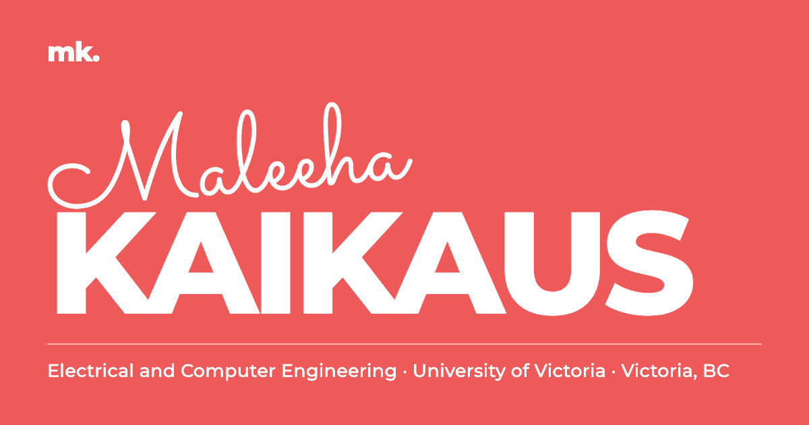

# Maleeha Kaikaus · Portfolio

Personal website of **Maleeha Kaikaus**, MASc student in Electrical and Computer Engineering at the University of Victoria.

**Live site: [mkaikaus.github.io](https://mkaikaus.github.io)**

## About me

I am a graduate student in Electrical and Computer Engineering at the University of Victoria, with an interest in privacy and security. I teach digital design labs to undergraduates, and before moving to Victoria I worked as a software engineer building React and Next.js applications. I have two peer-reviewed publications in deep learning.

## What you will find on the site

- **Projects**: SEAsk (Ocean Hackathon Victoria 2026), Door-to-Door, CS-Wiki and Seizure Detection
- **Experience**: laboratory instruction at the University of Victoria and software engineering at Intercloud Limited, plus volunteering and other work
- **Publications**: two peer-reviewed papers, listed below
- **Skills, education and resume**
- **Contact form** and links

## Highlights

- **Scroll-driven storytelling.** Sections pin, titles move with the scroll, and the project gallery travels horizontally.
- **Real-time 3D.** A particle scene built with Three.js reshapes itself for each section and responds to the pointer.
- **Bilingual.** English and French, switchable at any time without a reload. The choice is remembered.
- **Light and dark themes.** The site follows the visitor's system setting and offers a manual switch.
- **Accessible by design.** Fully keyboard navigable, with a calm version for visitors who prefer reduced motion. The page stays usable if 3D graphics are unavailable.
- **Lightweight.** No framework and no build step. Libraries are self-hosted, so the site has no third-party script dependencies at runtime.

## Built with

| Area | Technology |
| --- | --- |
| Structure and styling | HTML5, CSS3 (custom properties, grid, sticky positioning) |
| Behaviour | Vanilla JavaScript |
| 3D graphics | [Three.js](https://threejs.org) |
| Smooth scrolling | [Lenis](https://lenis.darkroom.engineering) |
| Contact form | [Web3Forms](https://web3forms.com) |
| Typography | Montserrat, Merriweather and Sacramento (Google Fonts) |
| Hosting | GitHub Pages |

## Repository structure

| Path | Contents |
| --- | --- |
| `index.html` | Page structure and metadata |
| `css/style.css` | All styling, including both colour themes |
| `js/i18n.js` | English and French text |
| `js/scene.js` | The 3D particle scene |
| `js/main.js` | Scrolling, navigation, theme, language and contact form |
| `vendor/` | Self-hosted libraries |
| `media/` | Resume and project demos |

## Publications

- **SeizureFed: Federated Learning for Pediatric Seizure Detection through EEG Using E-ResNet.** Proceedings of the 3rd International Conference on Computing Advancements (ICCA 2024), ACM, 2025, pp. 838–846. [View record](https://researchoutput.csu.edu.au/en/publications/fd8f91ea-cfb1-443d-9772-8e2bc14e70ca)
- **Novel Deep Learning for Multi-Class Classification of Alzheimer's in Disability Using MRI Datasets.** Frontiers in Bioinformatics, vol. 5, 2025. [doi:10.3389/fbinf.2025.1567219](https://doi.org/10.3389/fbinf.2025.1567219)

## Contact

- Email: [maleehakaikaus.official@gmail.com](mailto:maleehakaikaus.official@gmail.com)
- LinkedIn: [maleeha-kaikaus](https://www.linkedin.com/in/maleeha-kaikaus/)
- GitHub: [@mkaikaus](https://github.com/mkaikaus)

---

© 2026 Maleeha Kaikaus. All rights reserved.
